<a id="top"></a>

<picture>
  <source media="(prefers-color-scheme: dark)" srcset="docs/media/fairfold-hero-dark.svg">
  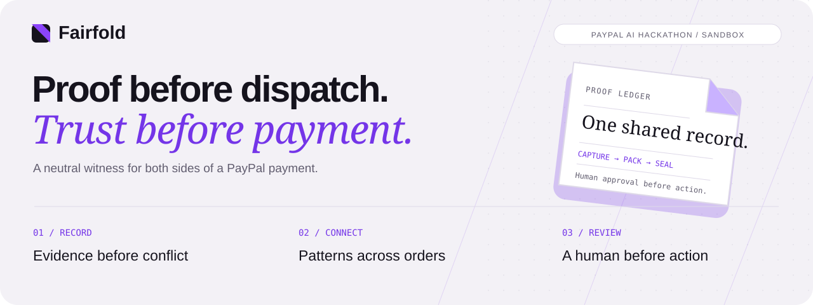
</picture>

# Fairfold

**One side’s proof becomes the other side’s trust.**

Fairfold records packing proof, connects repeated complaints and prepares grounded dispute responses around a PayPal payment. Buyers and merchants see the context; **humans approve actions, and PayPal decides disputes.**

Built by **Hriday and Ishaan** for the [PayPal AI Hackathon](https://paypalaihackathon.devpost.com/). **[MIT](LICENSE)** · PayPal sandbox only.

**[Open live demo ↗](https://fairfold-api.onrender.com)** · **[Merchant console ↗](https://fairfold-api.onrender.com/console/orders)** · **[API docs ↗](https://fairfold-api.onrender.com/docs)**

**[Live tour ↓](#explore-the-live-demo)** · **[Original visual tour ↓](#see-the-website)** · **[PayPal + AI](#paypal-is-the-payment-layer)** · **[Run locally](#run-locally)** · **[Evidence](#evidence-you-can-inspect)** · **[Changes and uploads ↓](#changes-and-uploads)**

### Built on PayPal and hosted on Render

|                           | What Fairfold uses                                                                                                                                                                                                                                                                                                                                                                                 | State                                                                                                                                                                                                                                                           |
| :------------------------ | :------------------------------------------------------------------------------------------------------------------------------------------------------------------------------------------------------------------------------------------------------------------------------------------------------------------------------------------------------------------------------------------------- | :-------------------------------------------------------------------------------------------------------------------------------------------------------------------------------------------------------------------------------------------------------------- |
| **PayPal (sandbox only)** | JavaScript SDK v6 + Orders v2 checkout/capture, per-merchant OAuth, Webhooks, Orders tracking, Customer Disputes v1, Payments v2 refunds, Agent Toolkit (`context.sandbox = true`) and Fairfold's MCP server. Every call goes through [`packages/paypal`](packages/paypal); every evidence submission, hold, message, offer and refund needs explicit human approval, and PayPal decides disputes. | Code integrated and tested. A sandbox Business + Personal account pair exists and sandbox OAuth with read-only checks passed; hosted credential activation, webhook registration and a real purchase are **pending**. [Details ↓](#paypal-is-the-payment-layer) |
| **Render**                | One web service serves the website and API on the same origin, a background worker runs webhook/reconciliation/watchdog jobs, and a private PostgreSQL 16 database holds the ledger, defined in [`render.yaml`](render.yaml). Deploys are manual.                                                                                                                                                  | **Live** at [fairfold-api.onrender.com](https://fairfold-api.onrender.com) with synthetic seeded data. [Details ↓](#deploy-on-render)                                                                                                                           |

> **Live on Render · synthetic demo.** Website, API, worker and private PostgreSQL are deployed. Hosted desktop/mobile and MCP checks passed. Real PayPal, provider/photo and complete hosted A1–A14 acceptance remain pending. [Deployment receipt →](docs/hriday/evidence/2026-11-13-render-live.md) · [Earlier local evidence →](docs/hriday/evidence/2026-11-12-website.md)

<p align="center">
  <a href="#follow-one-order">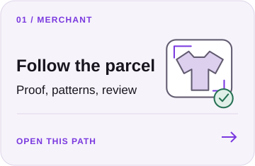</a>
  <a href="docs/media/captures/report.png">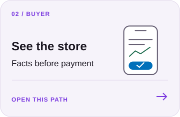</a>
  <a href="#architecture-you-can-trace">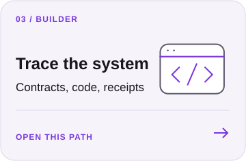</a>
</p>

## Explore the live demo

<a href="https://fairfold-api.onrender.com/console/orders">
  <picture>
    <source media="(max-width: 600px)" srcset="docs/media/render/overview-mobile.svg">
    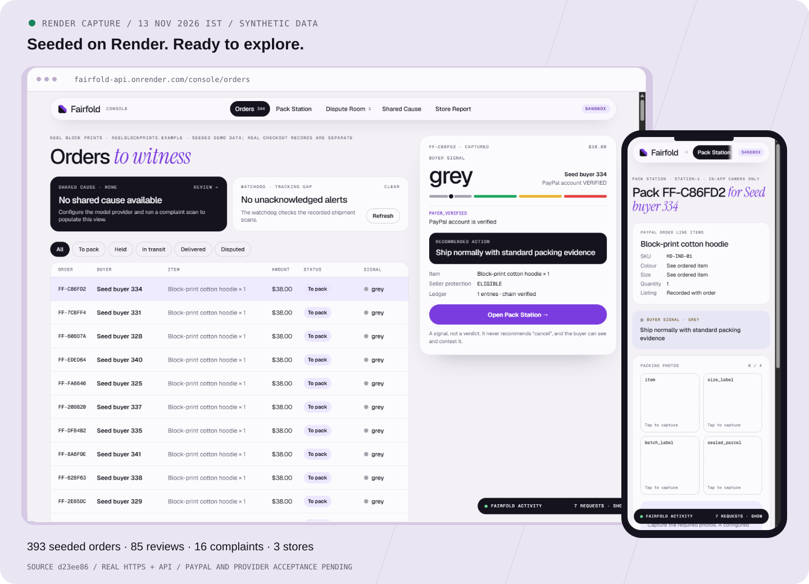
  </picture>
</a>

**Click the image to open the working console.** No account sign-up is needed for the seeded merchant demo; its token stays in browser memory. All records shown are synthetic. The interface, fonts and components are the existing website, captured from its real Render API.

| Explore                                                                                                                                                                      | What is actually there                                                                                              |
| :--------------------------------------------------------------------------------------------------------------------------------------------------------------------------- | :------------------------------------------------------------------------------------------------------------------ |
| [Orders →](https://fairfold-api.onrender.com/console/orders)                                                                                                                 | **344 Neel orders**, filters, Buyer Signal reasons and verified ledger reads                                        |
| [Pack Station →](https://fairfold-api.onrender.com/console/pack)                                                                                                             | Selected-order state, required photo slots, batch choices and review gates; real camera/model checks remain pending |
| [Dispute Room →](https://fairfold-api.onrender.com/console/disputes)                                                                                                         | One explicitly seeded, resolved dispute; real sandbox acceptance is separate                                        |
| [Shared Cause →](https://fairfold-api.onrender.com/console/shared-causes)                                                                                                    | An honest empty state until a provider-backed complaint scan runs                                                   |
| [Store Report →](https://fairfold-api.onrender.com/console/store-report)                                                                                                     | Computed fulfilment facts, retained reviews and comparison-store bands                                              |
| [API explorer →](https://fairfold-api.onrender.com/docs) · [OpenAPI JSON](https://fairfold-api.onrender.com/docs/json) · [Health](https://fairfold-api.onrender.com/healthz) | Same-origin REST/OpenAPI and actual database readiness; authenticated MCP is mounted at `/mcp`                      |

The complete seeded world contains **393 orders, 85 reviews and 16 complaints across three stores**. Store bands are **verified / verified / caution**. These are fixture counts and computed fixture results, not customers, traction or successful sandbox payments. The missing provider does not produce a substitute hypothesis. Public demo sign-in is demo access control; use synthetic data only and review every action before approval.

<details>
<summary><strong>Play the hosted tour</strong> · six real Render screens, 20.4 seconds</summary>

<picture>
  <source media="(prefers-reduced-motion: reduce)" srcset="docs/media/render/tour-still.png">
  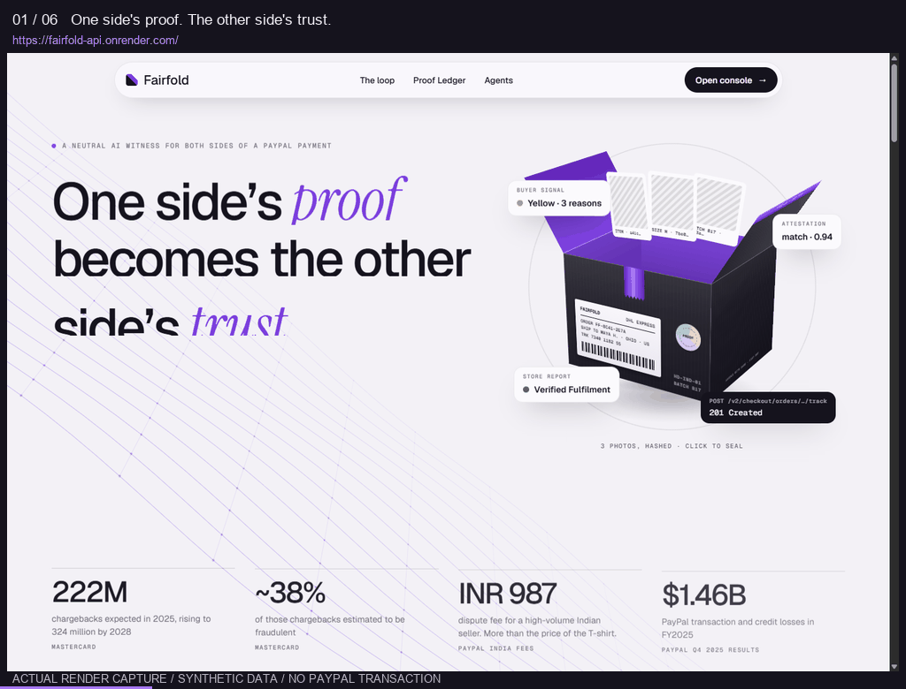
</picture>

This is a sequence of actual hosted captures, not a continuous transaction recording. [Still frame](docs/media/render/tour-still.png) · [Capture provenance and hashes](docs/media/render/README.md) · [Live deployment evidence](docs/hriday/evidence/2026-11-13-render-live.md).

</details>

<details>
<summary><strong>Inspect the hosted originals</strong> · full-resolution screens and mobile capture</summary>

<p align="center">
  <a href="docs/media/render/captures/orders.png">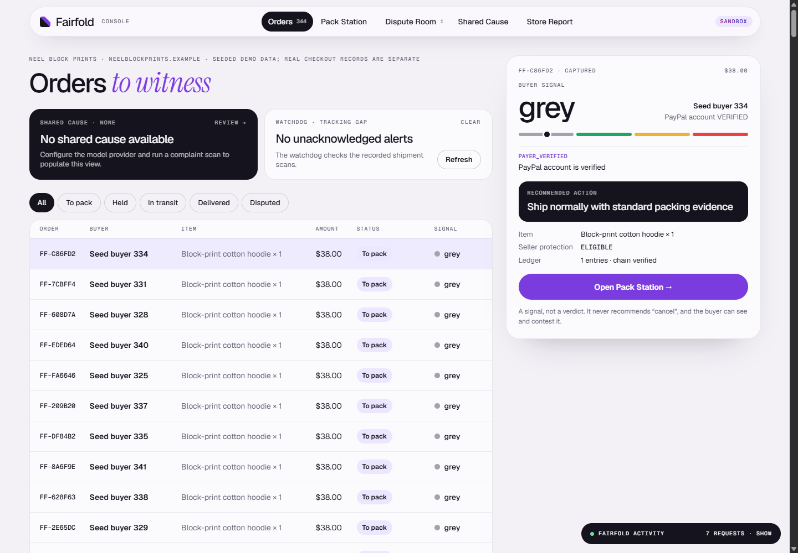</a>
  <a href="docs/media/render/captures/report.png"></a>
  <a href="docs/media/render/captures/pack.png">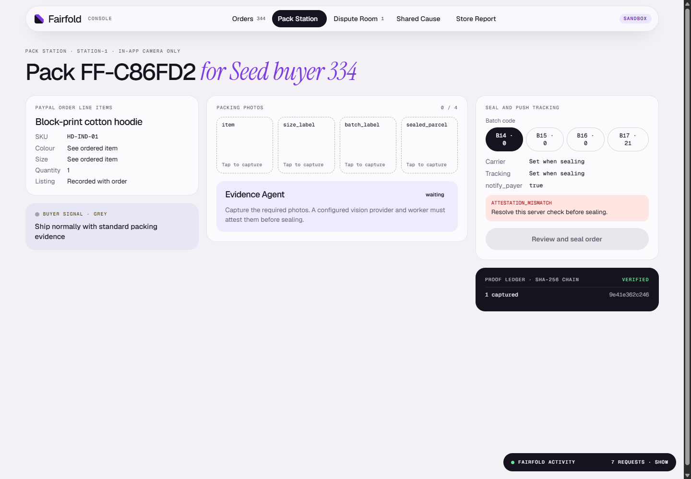</a>
  <a href="docs/media/render/captures/disputes.png"></a>
</p>

[Landing](docs/media/render/captures/landing.png) · [Orders](docs/media/render/captures/orders.png) · [Packing](docs/media/render/captures/pack.png) · [Mobile packing](docs/media/render/captures/pack-mobile.png) · [Disputes](docs/media/render/captures/disputes.png) · [Shared Cause empty state](docs/media/render/captures/shared-cause.png) · [Store Report](docs/media/render/captures/report.png).

Captured **13 November 2026 IST**, deployed source **`d23ee86`**. The website's own control folds the activity dock; original screenshots are otherwise unaltered. Presentation frames and tour captions sit outside the UI. The earlier local gallery and its provenance are preserved below.

</details>

## See the website

[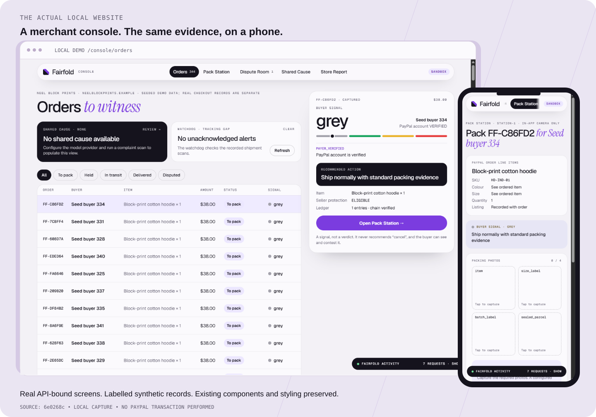](docs/media/captures/orders.png)

The existing components, fonts, colours and animations are preserved. Orders, packing state, ledger checks, disputes, shared causes and reports now come from the API. Click the image for the full-resolution console.

<details>
<summary><strong>Play the 19-second website tour</strong> · six actual local routes, no payment performed</summary>

<picture>
  <source media="(prefers-reduced-motion: reduce)" srcset="docs/media/console-tour-still.png">
  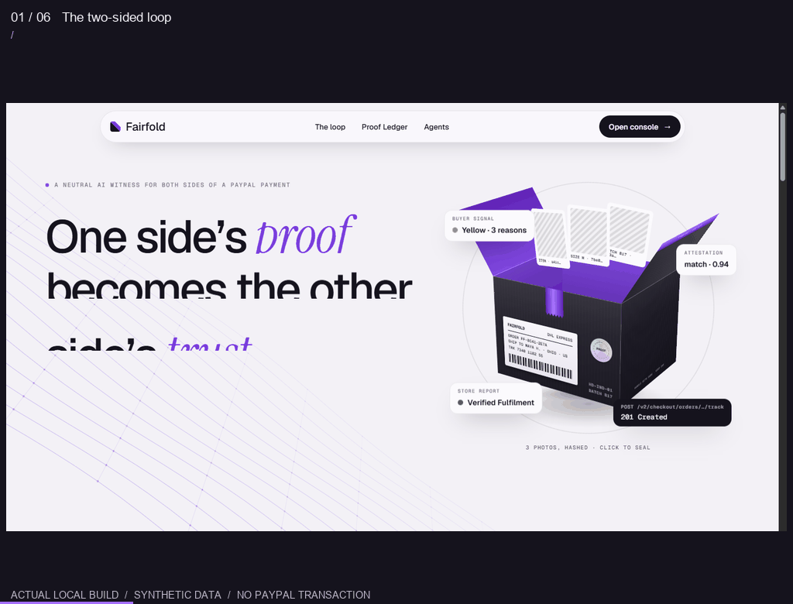
</picture>

This is a captioned sequence of real screen captures, not a recorded sandbox transaction. Shared Cause stays empty without provider-backed embeddings. [Still frame](docs/media/console-tour-still.png) · [Captures and provenance](docs/media/README.md).

</details>

<details>
<summary><strong>Inspect a screen</strong> · full-resolution, without animation</summary>

Click any screen to inspect the original capture. The gallery shows the local website with synthetic records.

<p align="center">
  <a href="docs/media/captures/landing.png">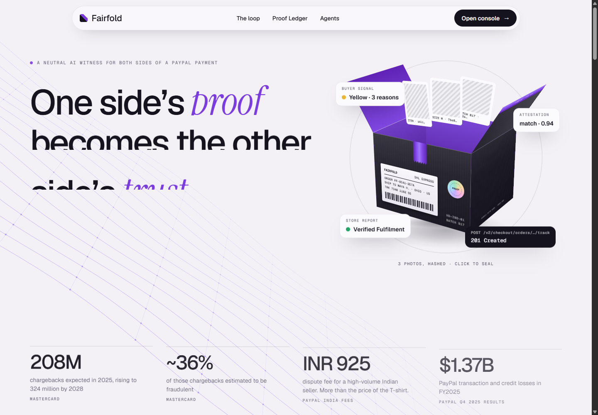</a>
  <a href="docs/media/captures/orders.png"></a>
  <a href="docs/media/captures/pack.png"></a>
  <a href="docs/media/captures/disputes.png">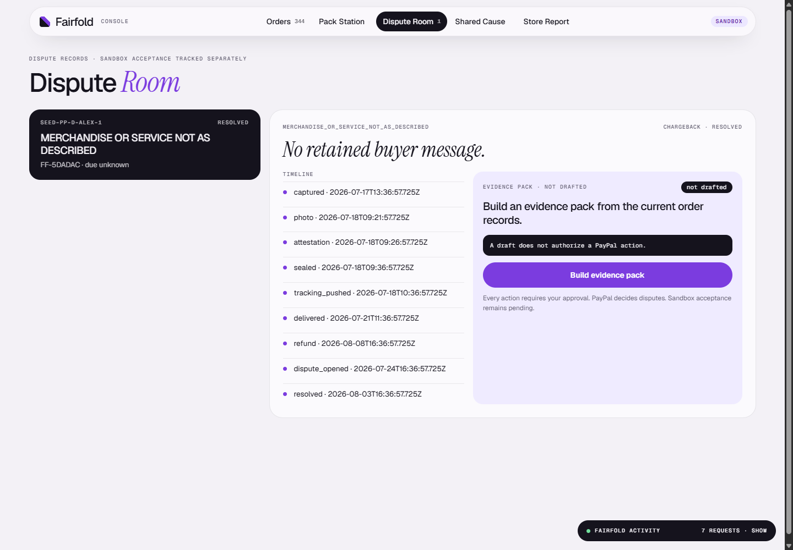</a>
  <a href="docs/media/captures/shared-cause.png">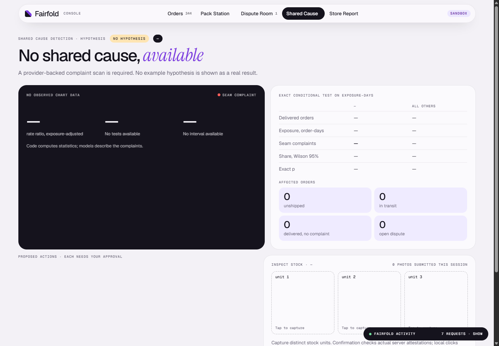</a>
  <a href="docs/media/captures/report.png">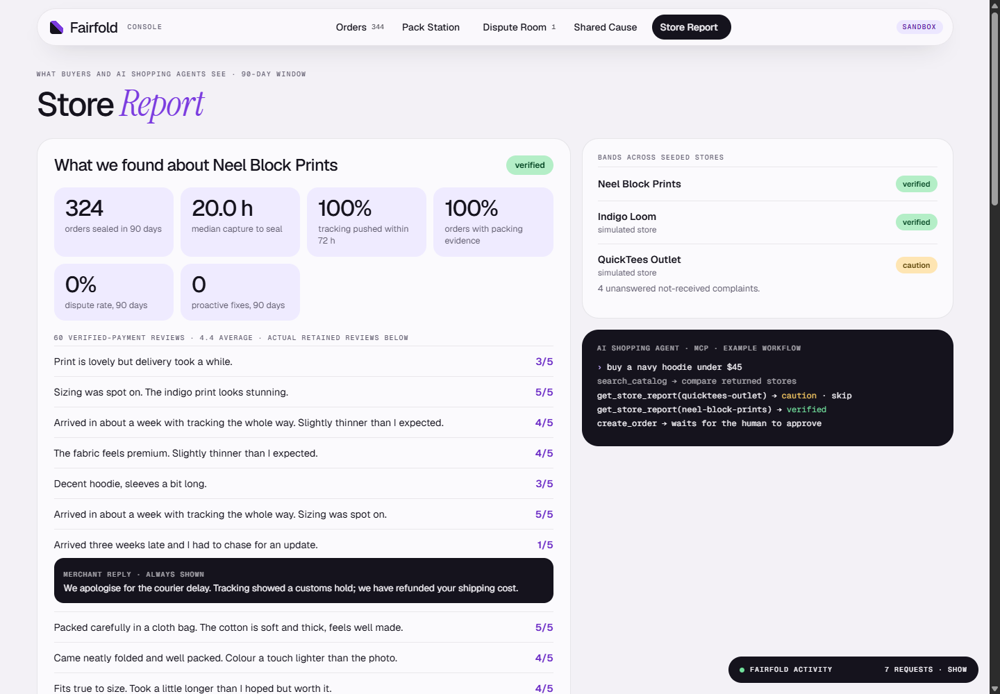</a>
</p>

| Screen                                                                                       | What to look for                                                        |
| :------------------------------------------------------------------------------------------- | :---------------------------------------------------------------------- |
| [Landing](docs/media/captures/landing.png)                                                   | The two-sided proof and trust loop                                      |
| [Orders](docs/media/captures/orders.png)                                                     | Buyer Signal reasons, seller-protection fields, filters and alerts      |
| [Pack Station](docs/media/captures/pack.png) · [mobile](docs/media/captures/pack-mobile.png) | Required photos, actual server blockers, batch selection and the ledger |
| [Dispute Room](docs/media/captures/disputes.png)                                             | Retained dispute facts; this capture shows a seeded resolved dispute    |
| [Shared Cause](docs/media/captures/shared-cause.png)                                         | A truthful empty state when embeddings are missing                      |
| [Store Report](docs/media/captures/report.png)                                               | Computed fulfilment facts and retained reviews with merchant replies    |

</details>

## Follow one order

<picture>
  <source media="(max-width: 600px)" srcset="docs/media/evidence-journey-mobile.svg">
  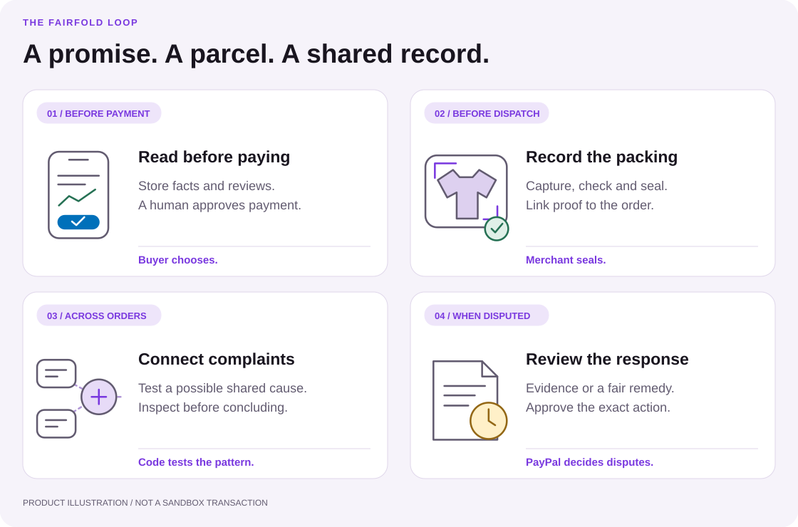
</picture>

A small exporter ships a carefully packed order. A buyer receives a torn seam. PayPal sees a dispute. Fairfold connects what was packed, what was promised and whether other orders share the fault.

We build for small merchants, including Indian exporters selling to overseas PayPal buyers. The same record helps an honest merchant show what happened and helps an honest buyer receive a remedy when the evidence points to a real fault.

<details>
<summary><strong>Expand each moment and its control</strong> · the complete product flow</summary>

| Moment                     | Fairfold’s job                                                                                                               | Who stays in control                                                |
| :------------------------- | :--------------------------------------------------------------------------------------------------------------------------- | :------------------------------------------------------------------ |
| **Before payment**         | A Store Report exposes fulfilment facts and verified-payment reviews. An AI shopper reads the same report through MCP.       | The buyer or supervising human chooses whether to pay.              |
| **Before dispatch**        | The Pack Station captures photos, checks them against ordered items, records batch codes and seals a SHA-256 evidence chain. | The merchant resolves blockers and explicitly seals.                |
| **When complaints repeat** | Shared Cause Detection tests for a common batch, courier, listing or packing context and proposes affected-order actions.    | The merchant reviews each hold, message, offer or refund.           |
| **When a dispute opens**   | Fairfold joins the PayPal capture to order proof and builds an evidence pack with a recommended response or remedy.          | The merchant approves the exact action; PayPal decides the dispute. |

</details>

<details>
<summary><strong>Unfold the B17 story</strong> · the intended climax, with evidence boundaries</summary>

[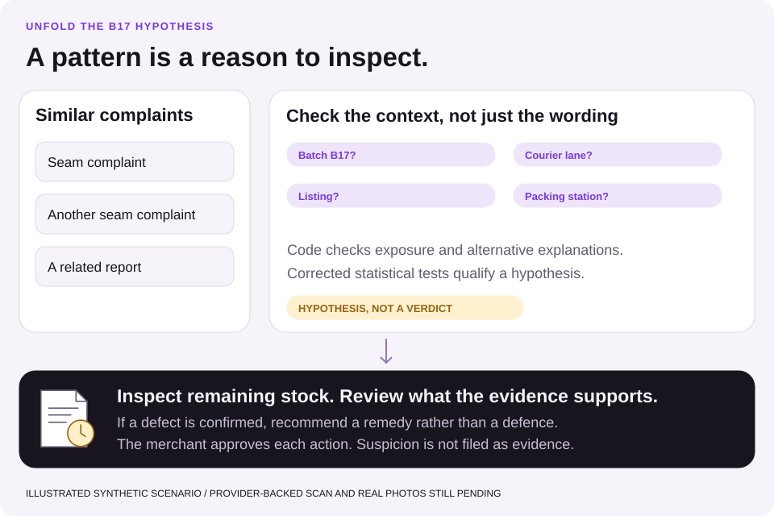](docs/media/b17-investigation.svg)

Maya’s damaged hoodie could be an isolated incident. Similar seam complaints may instead implicate one production batch. Fairfold reads the complaints, then code checks exposure, alternatives and statistical strength before selecting affected orders.

If a stock inspection supports the hypothesis, the merchant can approve a remedy. The product is useful even when the correct response is to help the buyer rather than contest the claim.

The repository includes the labelled synthetic B17 world. Missing embeddings leave new complaints pending; they do not activate a substitute clustering algorithm or invent a hypothesis. A provider-backed scan, real inspection photos and Maya’s actual sandbox purchase/dispute still need separate acceptance. [Seed](apps/api/src/seed/world.ts) · [Shared Cause code](packages/intelligence/src/sharedCause) · [Acceptance plan](docs/hriday/validation.md).

</details>

## PayPal is the payment layer

[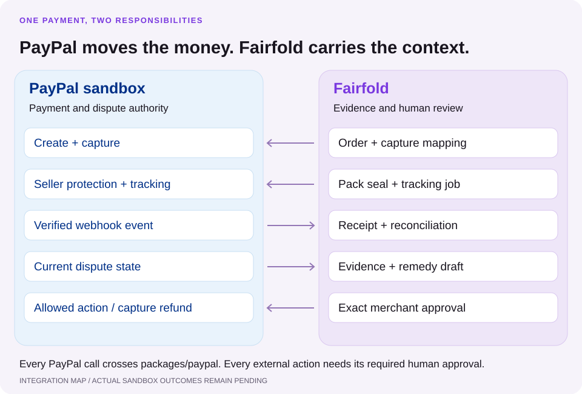](docs/media/paypal-lifecycle.svg)

The payment, capture, seller-protection context, tracking and dispute lifecycle belong to PayPal. Fairfold adds evidence and review around that lifecycle. There is no alternate payment provider and no change to Buyer Protection.

<details>
<summary><strong>Open the PayPal integration map</strong> · every surface linked to its code</summary>

| PayPal surface                    | Where it matters in Fairfold                                                              | Inspect the implementation                                                                                          |
| :-------------------------------- | :---------------------------------------------------------------------------------------- | :------------------------------------------------------------------------------------------------------------------ |
| **JavaScript SDK v6 + Orders v2** | Human-approved checkout, create/capture and seller-protection context                     | [Harness](apps/api/src/dev) · [Orders](packages/paypal/src/orders.ts)                                               |
| **OAuth per merchant**            | Encrypted app secrets and scoped token caching                                            | [Credentials](packages/paypal/src/credentials.ts) · [Transport](packages/paypal/src/transport.ts)                   |
| **Webhooks**                      | Original bytes for verification, durable receipt, deduplication and reconciliation        | [Ingress](packages/paypal/src/event-ingress.ts) · [Verification](packages/paypal/src/webhooks.ts)                   |
| **Orders tracking**               | Sealing queues tracking; queued work is distinct from PayPal success                      | [Tracking](packages/paypal/src/tracking.ts) · [Execution](packages/paypal/src/tracking-execution.ts)                |
| **Customer Disputes v1**          | Re-fetch current state, review an exact pack, then provide evidence or an allowed remedy  | [Guards](packages/paypal/src/dispute-guards.ts) · [Execution](packages/paypal/src/dispute-execution.ts)             |
| **Payments v2 refunds**           | Approved remedies use capture-bound refunds and decimal-string money                      | [Payments](packages/paypal/src/payments.ts) · [Approved actions](packages/paypal/src/action-execution.ts)           |
| **Agent Toolkit + Fairfold MCP**  | A shopper reads trust information, asks its human, then uses sandbox create/capture tools | [Sandbox adapter](packages/paypal/src/shopper-toolkit.ts) · [MCP](apps/api/src/mcp) · [Shopper](apps/shopper-agent) |

</details>

The Toolkit adapter explicitly sets `context.sandbox = true`. All PayPal calls stay inside `packages/paypal`. The buyer opens a sandbox claim through PayPal’s own interface; Fairfold does not pretend a public dispute-creation endpoint exists. [Actual sandbox rehearsal →](docs/hriday/sandbox-rehearsal.md)

## AI describes. Code decides. Humans approve.

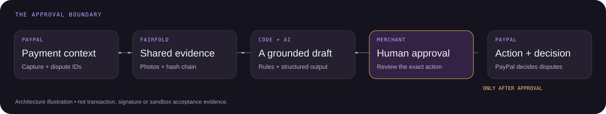

<details>
<summary><strong>Inspect the AI, code and human responsibilities</strong> · full rules and implementation links</summary>

| Models see, read and draft                                                           | Deterministic code computes                                                                                                                       | People authorize                                                                 |
| :----------------------------------------------------------------------------------- | :------------------------------------------------------------------------------------------------------------------------------------------------ | :------------------------------------------------------------------------------- |
| Visible photo features; complaint taxonomy; narratives; message drafts; explanations | Buyer points and reason codes; match decisions; grouping; exposure-adjusted tests and multiple-testing correction; recommendations and statistics | Evidence submissions, holds, messages, offers, refunds and the shopper’s payment |

Every model call goes through [`packages/ai`](packages/ai), built on the **Vercel AI SDK** for structured generation and embeddings. Third-party text is untrusted data, and outputs must match structured schemas. Extraction and drafting paths do not receive payment tools. Real buyer histories stay merchant-scoped; simulated network data is labelled. A new buyer with insufficient history gets **grey**, not a fraud verdict. [AI usage and measurement history](docs/ai-tools.md) · [Current decisions](DECISIONS.md).

</details>

<details>
<summary><strong>Inspect the last guard before a dispute action</strong></summary>

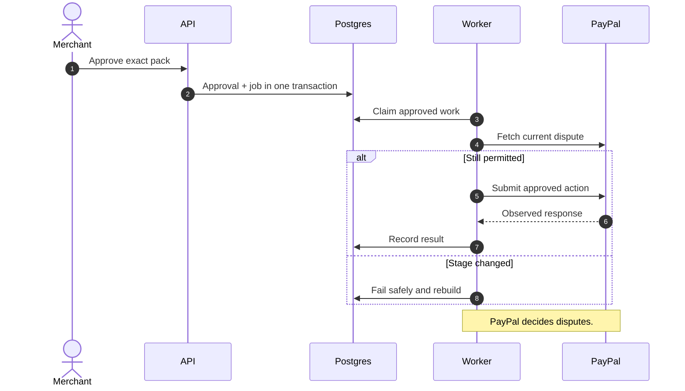

Approval is a durable record, not a label attached to a research runbook. The worker rechecks stage and ownership before an external effect. Return-address remedies stay blocked pending Q2 review. [Approval API](apps/api/src/disputes/approve.ts) · [Execution guards](packages/paypal/src/dispute-execution.ts).

</details>

<details>
<summary><strong>Flip the proof specimen</strong> · expand to see what changing one label does</summary>

[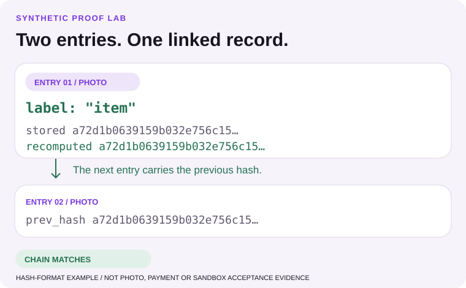](docs/media/proof-original.svg)

<details>
<summary><strong>Change <code>payload.label</code> → reveal the result</strong></summary>

[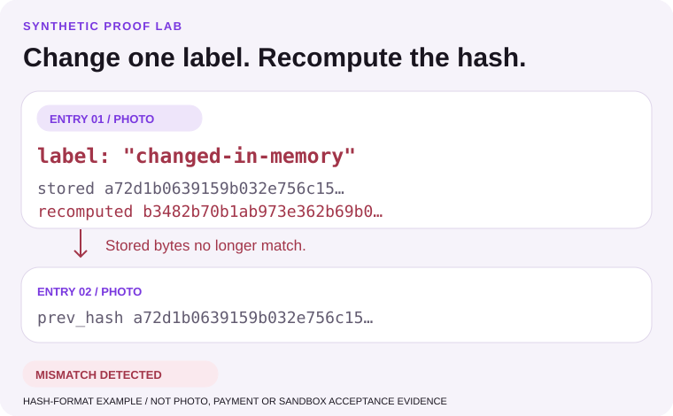](docs/media/proof-changed.svg)

These are precomputed views of the same specimen, checked by `pnpm docs:check`. Opening this disclosure performs no application action.

</details>

</details>

<details>
<summary><strong>Verify a proof specimen yourself</strong> · no database, model or PayPal needed</summary>

```sh
pnpm docs:check
```

This checks documentation assets and recomputes a [two-entry synthetic specimen](docs/media/proof-specimen.json) using Fairfold’s actual canonical JSON and SHA-256 functions. It changes one payload in memory and confirms that the chain no longer verifies.

```text
entry_hash = SHA256(previous_hash + canonical_JSON(entry_content))
```

This is a format demonstration, not stored order evidence. A chain exposes inconsistent stored bytes; it does not prove that a photographed item was honest, that payment occurred, or that a database operator never rewrote the entire chain. External anchoring is not implemented. [Hashing](packages/ledger/src/canonical.ts) · [Ledger](packages/ledger/src/ledger.ts).

</details>

## Architecture you can trace

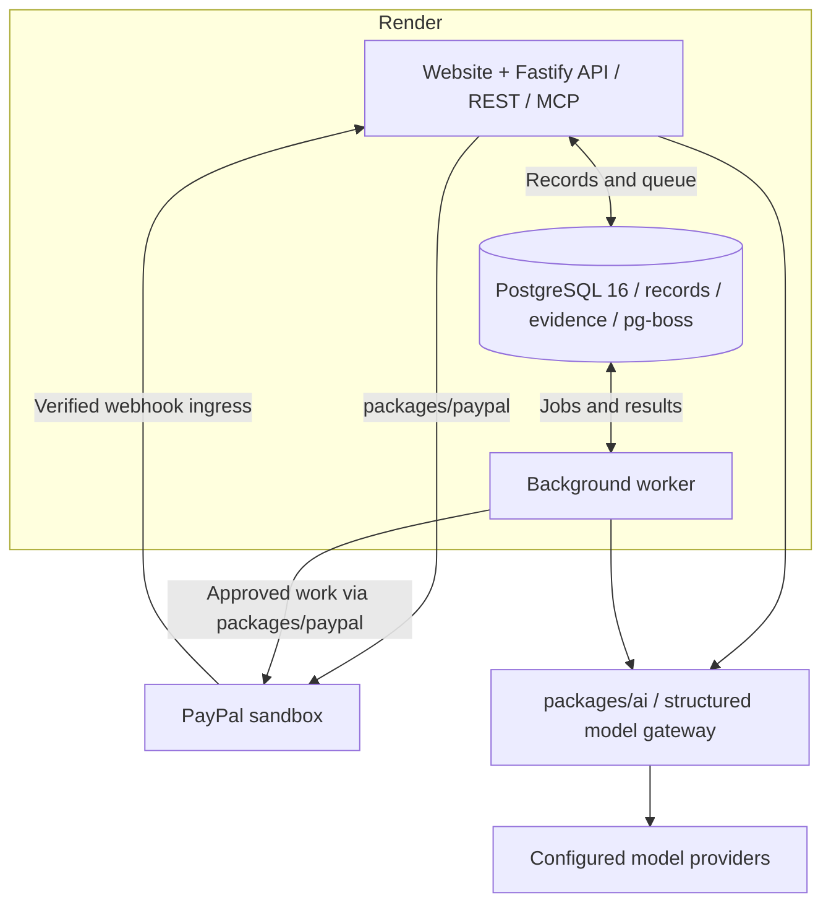

One origin serves the website, REST/OpenAPI and MCP. One long-running worker handles queue jobs. PostgreSQL stores records, the pg-boss queue and content-addressed evidence. All three are now live in Oregon, with the database restricted to private connections. [Actual resource/deploy receipts](docs/hriday/evidence/2026-11-13-render-live.md).

<details>
<summary><strong>Find a package or contract</strong></summary>

| Path                                                                            | Responsibility                                             |
| :------------------------------------------------------------------------------ | :--------------------------------------------------------- |
| [`apps/web`](apps/web)                                                          | Supplied frontend, routing and API-backed interactions     |
| [`apps/api`](apps/api)                                                          | REST, auth, uploads, OpenAPI, webhooks and MCP             |
| [`apps/worker`](apps/worker)                                                    | Jobs, retention and watchdog schedules                     |
| [`apps/shopper-agent`](apps/shopper-agent)                                      | Shopping policy with human approval pauses                 |
| [`packages/contracts`](packages/contracts)                                      | Shared schemas, clocks and job contracts                   |
| [`packages/paypal`](packages/paypal)                                            | Sandbox payment boundary                                   |
| [`packages/ledger`](packages/ledger)                                            | Canonical hashes, evidence blobs and verification          |
| [`packages/ai`](packages/ai) · [`packages/intelligence`](packages/intelligence) | Model gateway; evidence, signals, reports and Shared Cause |
| [`render.yaml`](render.yaml)                                                    | API/site, worker and PostgreSQL Blueprint                  |

Run `/docs` for generated OpenAPI, `/healthz` for database readiness, and `/mcp` for authenticated agent tools.

</details>

## Run locally

**Prerequisites:** Node.js 22.16+, pnpm 12.4.2 and Docker Compose, or an existing PostgreSQL 16 instance.

```sh
git clone https://github.com/vighriday/fairfold.git
cd fairfold
pnpm install --frozen-lockfile
pnpm setup:local
docker compose up -d --wait
pnpm db:migrate
pnpm seed
pnpm dev
```

Open **[localhost:3000](http://localhost:3000)** → **[merchant console](http://localhost:3000/console/orders)**. Use your configured `PORT` if it differs. `setup:local` generates ignored `.env` keys and preserves an existing file. Inspect that file first: a pre-existing `DATABASE_URL` may point somewhere else.

With `DEMO_MODE=true`, the console obtains the seeded Neel token in memory. This is demo authentication. The catalogue, stored records, deterministic logic and fixture checks work without PayPal credentials. Model-dependent work stays pending without its provider. The seed performs no PayPal transaction.

<details>
<summary><strong>Connect models, sandbox checkout or the shopper</strong></summary>

1. **Models:** configure the existing gateway’s provider, model IDs and embedding provider privately in `.env`. Verify access and quota in your account. Keep `CLUSTER_SIMILARITY=0.80`. [Configuration](docs/hriday/website-deployment.md#local-run) · [Gateway](packages/ai).
2. **PayPal:** create Neel’s sandbox business app and Maya’s personal account, then follow [the rehearsal](docs/hriday/sandbox-rehearsal.md). `/dev` is the JavaScript SDK checkout harness. Never use live endpoints or commit credentials.
3. **Shopper:** configure model access, sandbox credentials and a private, short-lived `SHOPPER_AGENT_TOKEN`, then run:

   ```sh
   pnpm --filter shopper-agent start -- "navy hoodie under $45"
   ```

The shopper skips caution stores, asks before a non-verified store, and pauses separately for PayPal approval. Its transcript must come from an actual run; none is manufactured here.

</details>

## Evidence you can inspect

[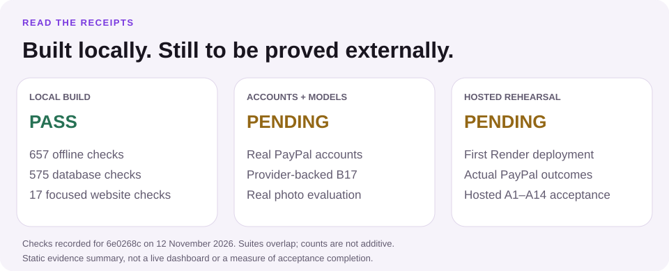](docs/media/verification-board.svg)

The illustration preserves the earlier local snapshot. **New hosted receipt:** migrations, synthetic seed, 16-handler worker startup, HTTPS health/docs, 344-order pagination, official scoped MCP and 12 desktop/mobile page states passed at `d23ee86`. [Inspect the dated Render evidence](docs/hriday/evidence/2026-11-13-render-live.md). Full account/provider/photo/A1–A14 acceptance is still separate.

<details>
<summary><strong>Open the full validation receipts</strong> · commands, scope and remaining acceptance</summary>

Recorded on **12 November 2026** for the website integration at `6e0268c`.[^checks]

| Verification                                   | Observed result                                                                             | Receipt                                                                                                                                   |
| :--------------------------------------------- | :------------------------------------------------------------------------------------------ | :---------------------------------------------------------------------------------------------------------------------------------------- |
| Offline suite                                  | **657 passed**, 319 gated skips, 0 failed                                                   | [Website evidence](docs/hriday/evidence/2026-11-12-website.md)                                                                            |
| Separate PostgreSQL suite                      | **575 passed**, 0 failed                                                                    | [Scope and limits](docs/hriday/evidence/2026-11-12-website.md#observed-checks)                                                            |
| Focused website checks                         | **17 passed**                                                                               | [Routes/transport](apps/web/test/website.test.ts) · [Approvals](apps/web/test/actions.test.ts) · [Serving](apps/api/test/website.test.ts) |
| Actual API + official MCP client               | **Passed**, zero PayPal requests                                                            | [Executable smoke](scripts/test-e2e.ts)                                                                                                   |
| Chromium desktop + mobile                      | **12 page states passed**, plus history, reload, keyboard selection and review cancellation | [Browser observations](docs/hriday/evidence/2026-11-12-website.md)                                                                        |
| Typecheck, build, lint, format, frozen install | **Passed**                                                                                  | [Recorded commands](docs/hriday/evidence/2026-11-12-website.md)                                                                           |
| Actual PayPal / provider-photo / hosted A1–A14 | **Pending**                                                                                 | [Status](docs/hriday/status.md) · [Acceptance plan](docs/hriday/validation.md)                                                            |

</details>

<details>
<summary><strong>Run the checks</strong> · local logic and external acceptance are separate</summary>

```sh
pnpm docs:check
pnpm typecheck
pnpm lint
pnpm format:check
pnpm test
pnpm test:db
pnpm test:e2e
pnpm --filter @fairfold/intelligence eval
pnpm --filter shopper-agent start --check
```

`test:db` requires a separate loopback PostgreSQL database named `fairfold_*test` in `TEST_DATABASE_URL`; it may truncate that synthetic database. `test:e2e` uses that guarded database and the actual API/MCP client. Fixture tests establish local behavior, not successful sandbox payments, real signatures, vision quality or hosted operation. Earlier model measurements retain their original settings and limitations in [Ishaan’s write-up](docs/ai-tools.md).

</details>

## Deploy on Render

**Deployed:** [Website](https://fairfold-api.onrender.com) · [Console](https://fairfold-api.onrender.com/console/orders) · [API docs](https://fairfold-api.onrender.com/docs) · [Health](https://fairfold-api.onrender.com/healthz).

[`render.yaml`](render.yaml) retains **web service + worker + PostgreSQL 16**, all from `main`. The web service builds the site and applies migrations before startup. Its Blueprint first-deploy hook seeds the labelled world; this actual manual deployment used one successful `pnpm seed` job because Blueprint capacity was blocked. Secrets stay private; site and API share the assigned origin.

**[Open the complete deployment guide →](docs/hriday/website-deployment.md#render-deployment)**

The approved manual deployment is verified at `d23ee86`: API/site and worker on Starter, PostgreSQL 16 with 1 GB, all in Oregon. Automatic deploys and storage growth are off; PostgreSQL's external allow-list is empty. Reuse existing resources and preserve the encryption key. Provider and PayPal secrets still need private setup. [Exact configuration and release steps](docs/hriday/manual-render-deployment.md) · [Observed deployment receipt](docs/hriday/evidence/2026-11-13-render-live.md). No alternate hosting architecture was introduced.

Next, configure the existing model gateway privately on **both** code services and verify access to the candidate models. Use the separate [hosted PayPal setup](docs/hriday/hosted-paypal-setup.md) to attach the sandbox Business app to the existing merchant. The [local sandbox rehearsal](docs/hriday/sandbox-rehearsal.md) keeps its local-database guard. Credential activation, real OAuth/webhook/purchase acceptance and human approvals remain pending; adding environment variables alone is not evidence that checkout works.

## Changes and uploads

**Recently merged to `main`:**

| Change                                                                                                                                                                                                                         | Commit               | Live on Render?                 |
| :----------------------------------------------------------------------------------------------------------------------------------------------------------------------------------------------------------------------------- | :------------------- | :------------------------------ |
| Drawn illustrations of the two fictional products (HD-IND-01 hoodie, TS-IND-02 T-shirt) on the landing buyer card, the console order rows and the Pack Station line items. They are catalogue artwork, never packing evidence. | `c45d887`            | **No: needs a manual redeploy** |
| Bounded `setup:sandbox:render` command that attaches the sandbox Business app to the existing hosted merchant, with service/database/sandbox guards. It makes no PayPal call.                                                  | `2ba9753`            | Deployed                        |
| Live demo links, hosted screenshot tour and deployment receipts in this README.                                                                                                                                                | `1ddb204`, `24abdf6` | Documentation only              |

**Still to upload or run.** These are done privately by the team; none of them is complete yet:

1. **Redeploy the API service on Render** from the latest `main`, so the website serves the product illustrations. Automatic deploys are off.
2. **Activate the PayPal sandbox app** using the reviewed [hosted PayPal setup](docs/hriday/hosted-paypal-setup.md):
   1. ~~Run sandbox OAuth and the read-only app and dispute checks.~~ **Done 13 Nov 2026 IST:** OAuth, webhook-list read and dispute-list read PASS with GET requests only (0 webhooks registered, 0 disputes visible).
   2. Set `PAYPAL_CLIENT_ID` and `PAYPAL_CLIENT_SECRET` temporarily on the API service, one key at a time. Never upload the whole `.env`.
   3. Run `pnpm setup:sandbox:render apply --confirm-service srv-dbr099on74is73b3i420` as a one-off job and confirm it prints `RENDER_SETUP_READY`.
   4. Remove the temporary keys.
   5. Run `pnpm exec tsx scripts/register-webhook.ts neel-block-prints` to register the seven-event sandbox webhook.
3. **Configure model access** on both the API and worker services, then run the provider-backed complaint scan and real photo evaluation.
4. **Make one real sandbox purchase** through [`/dev`](https://fairfold-api.onrender.com/dev) with the Personal sandbox account, then verify the capture, ledger and signed webhook delivery.
5. **Upload the demo video** to YouTube (public, under three minutes), then add its link and the Devpost submission here.

Credentials, tokens and buyer email addresses never go into Git, chat or logs. Purchases, refunds, offers, messages and evidence submissions each still need their own human approval.

<details>
<summary><strong>Submission readiness</strong> · remaining human steps</summary>

- [x] Combined `main`, the routed website and local verification.
- [x] Source, setup instructions, MIT licence and a PayPal/AI implementation map.
- [ ] Configure model access; evaluate provider-backed B17 and real photos.
- [ ] Complete Neel/Maya accounts, the spike, actual checkout/capture and verified sandbox webhook delivery.
- [ ] Observe exact human-approved PayPal outcomes; resolve Q2 return-address review.
- [x] Deploy and observe Render: website/API, private database, seed, worker startup and read-only browser/MCP smoke.
- [ ] Run complete hosted A1–A14 acceptance, including the actual account/provider/photo gates and recurring worker operations.
- [ ] Record the functioning project and add actual submission/video links.

The [submission requirements](https://paypalaihackathon.devpost.com/#requirements) call for an interactable build or complete setup instructions and a functioning demo video under three minutes. Screenshots and mockups support that explanation; they do not replace the working demo. Nothing has been submitted or uploaded on the team’s behalf.

</details>

## Built by two people, for both sides

**Hriday** — platform, PayPal integration, evidence ledger, workers, MCP/shopper, website integration and verified Render deployment.

**Ishaan** — AI gateway, intelligence, Shared Cause Detection, reports/signals, fixtures and evaluation work.

The supplied frontend is preserved in [`standalone/`](standalone). [Media provenance](docs/media/README.md) explains every screenshot, animation and diagram.

**[MIT](LICENSE)** · [Changelog](CHANGELOG.md) · [Decisions](DECISIONS.md) · [Status](docs/hriday/status.md) · [Back to top ↑](#top)

[^checks]: Offline and database suites overlap; their counts are not additive. Screens show synthetic records. Local checks do not establish actual PayPal, model-photo or hosted acceptance.
